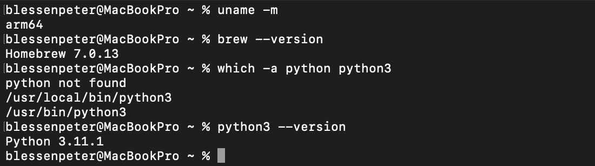
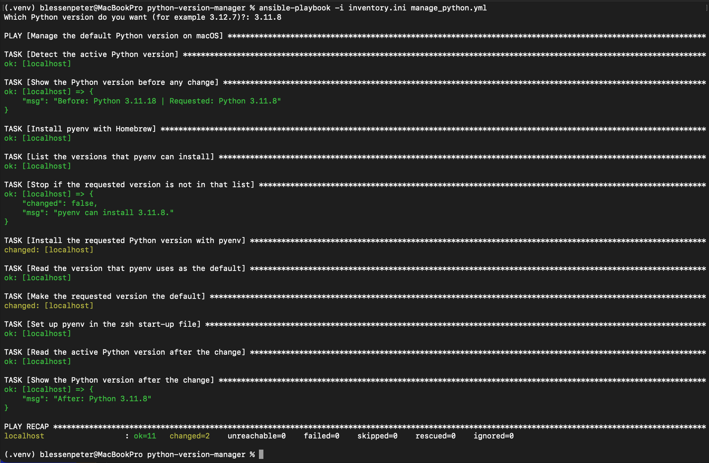
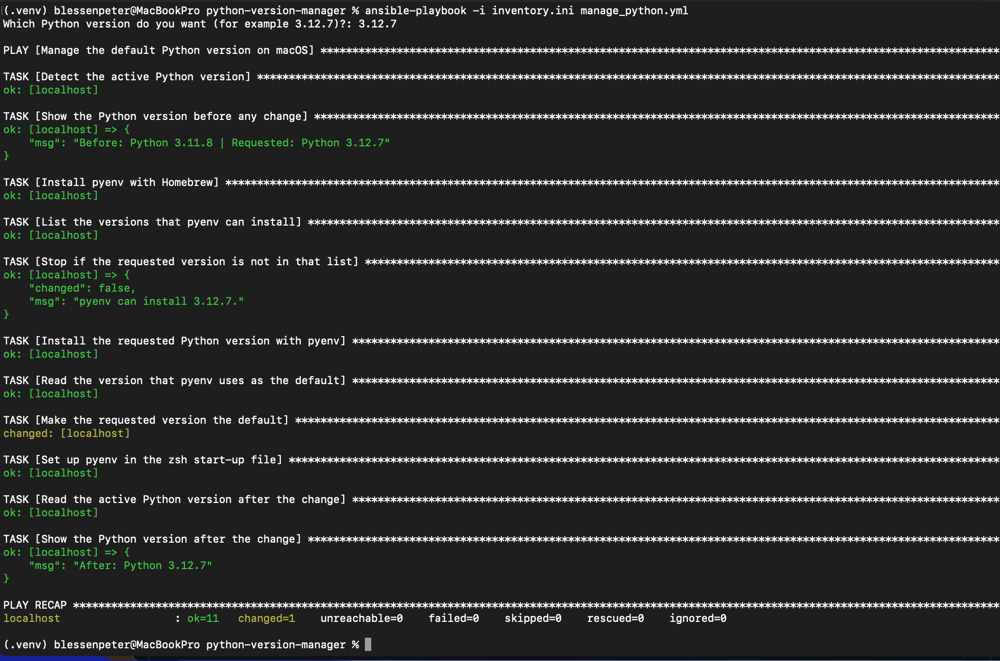
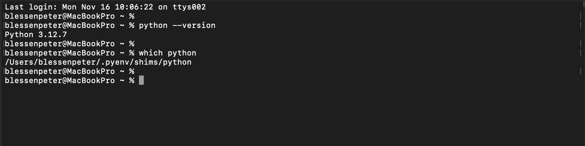
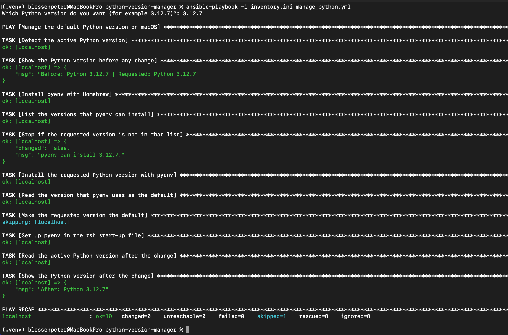
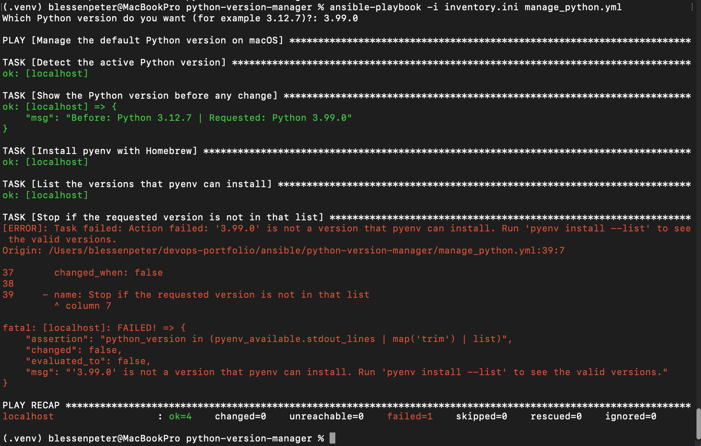

# Python version manager for macOS (Ansible)

An Ansible playbook that sets the default Python version on a Mac. You run one command, type the version you want, and `python` in every new terminal is that version. The playbook upgrades and downgrades, and a second run with the same version changes nothing.

## What it does

For `python` to be a chosen version in every terminal, four things must be true. The playbook makes each one true, and only does the work that is still missing.

| # | What must be true | How the playbook does it |
|---|---|---|
| 1 | pyenv is installed. pyenv keeps several Python versions side by side. | `community.general.homebrew` |
| 2 | The requested version is installed inside pyenv. | `pyenv install`, skipped when the version is already there (`creates`) |
| 3 | pyenv uses the requested version as its default. | `pyenv global`, run only when the default differs (`when`) |
| 4 | The shell uses pyenv. | `ansible.builtin.blockinfile` adds the pyenv set-up lines to `~/.zshrc` between two marker lines |

Before it installs anything, the playbook checks the requested version against the list of versions that pyenv can install, and stops with a clear message if the version is not in that list.

## Files

| File | Purpose |
|---|---|
| `manage_python.yml` | The playbook. |
| `inventory.ini` | The inventory: one group, `local`, with this Mac as its only host. |
| `screenshots/` | Output of the test runs shown below. |

## Requirements

- macOS on Apple silicon with zsh as the shell. The playbook expects pyenv at `/opt/homebrew/bin/pyenv`; on an Intel Mac, change the variable `pyenv_bin` to `/usr/local/bin/pyenv`.
- [Homebrew](https://brew.sh).
- Python 3 to create the virtual environment that holds Ansible.

Tested with ansible-core 2.19.15 and pyenv installed by Homebrew.

## Set-up

```bash
python3 -m venv .venv
source .venv/bin/activate
pip install ansible
```

## Usage

```bash
ansible-playbook -i inventory.ini manage_python.yml
```

The playbook asks for the version, for example `3.12.7`. To see the versions that can be requested:

```bash
pyenv install --list
```

Open a new terminal window after the first run. A shell reads `~/.zshrc` only when it starts, so windows that were already open do not see the pyenv set-up. Later version changes take effect at once in every window that uses pyenv.

The first installation of a version takes a few minutes, because pyenv builds Python from source.

## Test runs

### Starting point

Before the first run, the Mac has no `python` command, and `python3` is 3.11.1.



### Switch to a version that is not installed yet

3.11.8 is requested while 3.11.18 is the default. Two tasks report `changed`: the installation of 3.11.8 and the change of the default.



### Switch to a version that is already installed

3.12.7 is requested. It is already installed, so the installation task reports `ok` and only the change of the default reports `changed`.



### A new terminal uses the requested version

`python` is found in pyenv's `shims` folder and is version 3.12.7.



### Idempotency

A second run with the same version reports `changed=0`. The task that sets the default is skipped, and the block in `~/.zshrc` is left alone because its marker lines are already there.



### A version that does not exist

`3.99.0` is not in pyenv's list. The play stops at the check with `changed=0`, before any installation starts.



## Behaviour by starting state

| Requested | State before the run | `changed` | Work done |
|---|---|---|---|
| 3.12.7 | No pyenv lines in `~/.zshrc` | 1 | Block added to `~/.zshrc` |
| 3.12.7 | Everything already in place | 0 | None |
| 3.11.8 | Version not installed | 2 | Version installed and made the default |
| 3.12.7 | Installed, but not the default | 1 | Default switched |
| 3.99.0 | Any | 0 | None; the play stops at the version check |

## What the playbook changes on the Mac

- Installs pyenv with Homebrew.
- Builds the requested Python version under `~/.pyenv/versions/`.
- Sets pyenv's default version, which pyenv stores in `~/.pyenv/version`.
- Adds three lines to `~/.zshrc` between the markers `# BEGIN pyenv set-up, managed by Ansible` and `# END pyenv set-up, managed by Ansible`. A dated backup of `~/.zshrc` is saved before the file is changed.

## Undo

```bash
pyenv global system          # use the system Python again
pyenv uninstall 3.11.8       # remove a version that is no longer needed
```

To stop the shell from using pyenv, delete the marked block from `~/.zshrc` and open a new terminal window.
